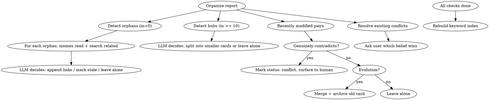

# Memory Organize

You are maintaining a Zettelkasten memory system. Your job is to keep the card network healthy.

## Commands

    memex organize [since]       # the maintenance report this skill acts on
    memex search [query]
    memex read <slug>
    memex write <slug> --title "..." [--category C] [--tags a,b] [--source S]
    memex links [slug]
    memex archive <slug>

An MCP client without a shell has the same operations as `memex_organize`,
`memex_search`, `memex_read`, `memex_write`, `memex_links` and
`memex_archive`, taking the same arguments as named fields.

## Process



1. Run `memex links` to get global link graph stats
2. **Orphan detection**: For cards with 0 inbound links:
   - `memex read` the orphan
   - `memex search` for potentially related cards
   - Decide: append a link from a related card to this orphan, or leave alone if truly standalone
3. **Hub detection**: For cards with >= 10 inbound links:
   - `memex read` the hub and its linkers
   - Decide: is this card too broad? Should it be split into smaller atomic concepts?
4. **Contradiction/staleness detection**: The organize report includes recently modified cards paired with their neighbors. For each pair:
   - Read both cards' content (excerpts are in the report, `memex read` for full content if needed)
   - Determine: do these cards **genuinely contradict** each other, or is one simply an **evolution** of the other?
   - **If evolution** (new info supersedes old): merge the cards — append the old card's unique content to the new one, then `memex archive` the old card
   - **If genuine contradiction** (two conflicting beliefs, unclear which is correct): mark the newer card with `status: conflict` and add a note explaining the contradiction. `status` has no `memex write` flag, so use the round-trip form — `memex read <slug> > /tmp/c.md`, edit the frontmatter line, `memex write <slug> < /tmp/c.md`. Do NOT auto-resolve — the human decides which belief wins
   - **If no conflict**: leave both cards alone
5. **Resolve existing conflicts**: Check the "Unresolved Conflicts" section. For each card with `status: conflict`:
   - Surface it to the user: "Card X conflicts with card Y — which perspective should we keep?"
   - If the user resolves it, remove `status: conflict` from frontmatter and merge/archive as directed
6. **Rebuild keyword index** (always — see below)
7. **Mark the run complete** (final step): `date -u +%Y-%m-%d > ~/.memex/.last-organize`. The tool layer does not do this for you — if you skip it, the next run cannot tell which cards are newly modified.

## Keyword Index Maintenance

The keyword index (`index` card) is a curated concept → card mapping, inspired by Luhmann's Schlagwortregister. It is the primary entry point for the recall skill.

After completing all checks, rebuild the index:

1. `memex search` (no args) to get all card slugs and titles
2. `memex read` each card (or at least new/modified ones)
3. Group cards by concept/topic — use your judgment to create meaningful categories
4. Write the index card. Pass the body on stdin; `created` is preserved from
   the existing index card and `modified` is stamped:

```sh
memex write index --title "Keyword Index" --source organize <<'EOF'
## <Concept Category 1>
- [[slug-a]] — one-line description
- [[slug-b]] — one-line description

## <Concept Category 2>
- [[slug-c]] — one-line description
EOF
```

Rules for the index:
- Each card should appear under 1-2 categories (not more)
- Categories should be meaningful concepts, not arbitrary groupings
- Descriptions should be one line, explaining what the card is about (not just the title)
- Archived cards must be removed from the index
- New cards must be added

Use `memex write index` to save the index.

## Incremental Strategy

1. Read last run date: `cat ~/.memex/.last-organize 2>/dev/null`
2. If the file exists, only process cards where frontmatter `modified` >= that date, plus their linked neighbors
3. If the file doesn't exist, this is the first run — process all cards
4. After all maintenance *and* the index rebuild, write today's date (Process step 7). The file marks the run as actually completed, so write it only once the workflow is finished — not when the report tool returns.

When this skill creates cards (e.g. splitting hubs), tag them with `memex write <slug> --title "..." --source organize`. That keeps them distinguishable from cards a session wrote about its own work.

## Operation Rules

- **Append only**: When adding links to existing cards, append to the end of the body. Never modify existing prose.
- **Merge**: Read both cards, append source content to target card via `memex write`, then `memex archive` the source.
- **Archive**: Use `memex archive <slug>` to move stale cards out of active search.
- **No raw secrets**: Never search for or write actual secrets, credentials, tokens, or exact secret file contents. Use redacted examples and abstract descriptions instead.
- **Be conservative**: When in doubt, leave cards alone. It's better to under-organize than to break useful connections.
