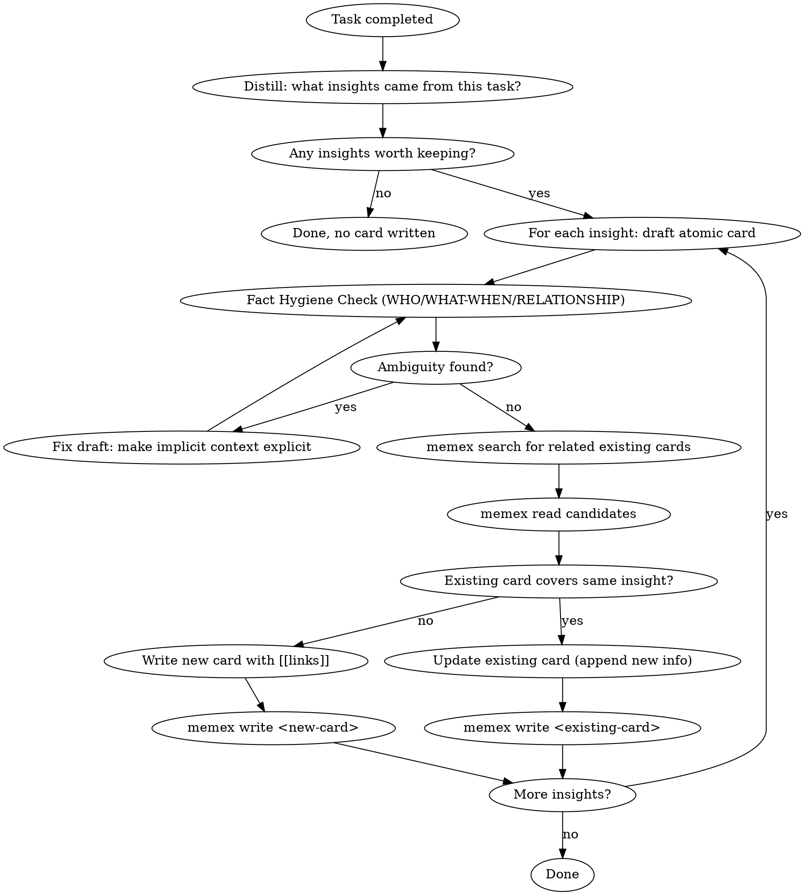

# Memory Retro

You have access to a Zettelkasten memory system via the `memex` CLI. After completing this task, reflect on what you learned and save valuable insights.

## Commands

    memex search --limit 5 <keywords>    # 1-3 keywords, AND-matched
    memex read <slug>
    memex write <slug> --title "..." [--category C] [--tags a,b] [--source S]

An MCP client without a shell has the same operations as `memex_search`,
`memex_read` and `memex_write`, taking the same arguments as named fields.

## Process



1. Ask yourself: what did I learn from this task that would be useful in the future?
2. If nothing worth remembering, skip — not every task produces insights
3. For each insight, draft an **atomic card** (one insight per card)
4. **Fact Hygiene Check** — before writing, scan the draft for implicit context that a stranger (or future AI) couldn't decode. Ask three questions:
   - **WHO**: Every project/product/team mentioned — is it the user's own work or external? Would a reader with zero context know?
   - **WHAT-WHEN**: Every number (days, tokens, cost) — is it bound to a specific project name and time period?
   - **RELATIONSHIP**: Words like "对标/参照/基于/借鉴/reference" — spell out the actual relationship (authored, benchmarked against, forked from, inspired by, etc.)
   - If any answer is "a stranger couldn't tell", **fix the draft before writing**. One sentence of context prevents hallucinated narratives downstream.
5. Before writing, `memex search` for related existing cards
6. **Dedup check**: If an existing card already covers this insight, `memex read` it, then update it by appending new information (use `memex write` with the full updated content)
7. If it's genuinely new, write a new card with `[[links]]` to related cards in the prose
8. **Present what you wrote** — name the slugs and the one-line claim each makes. If several cards are involved, or any of them changes an existing belief, show them before writing and let the user decide what is kept. This is a memory the user lives with for years.

## Writing a card

Pass the body on stdin and the metadata as flags. **Do not hand-write YAML
frontmatter** — the binary owns the card format:

```sh
memex write <slug> --title "Short noun phrase" --category <area> --tags 'a,b' <<'EOF'
<one atomic insight, in your own words>

<sentences with [[links]] that explain the relationship>
EOF
```

`created`, `modified` and `source` are stamped for you. On an existing card,
`created` and any fields you do not pass are preserved.

## Rules

- **Atomic**: One insight per card. If you have 3 insights, write 3 cards.
- **Own words**: Don't copy-paste. Distill and rephrase — this is the Feynman method.
- **Link in context**: `[[links]]` must be embedded in sentences that explain the relationship.
  - Good: "This contradicts what we found in [[jwt-migration]] — stateless tokens can't be revoked."
  - Bad: "Related: [[jwt-migration]]"
- **Slug**: English kebab-case, descriptive. e.g., `jwt-revocation-blacklist-pattern`
- **Don't over-record**: Only save insights that would change how you approach a similar task in the future.
- **Appending to a card**: pipe it through — `memex read <slug> > /tmp/c.md`, append the new paragraph, `memex write <slug> < /tmp/c.md`. Frontmatter is preserved for you; only `modified` is bumped. Append only when the card covers the **same insight**; if what you learned contradicts it, write a new card linking the old one instead, so `memex organize` can surface the pair.
- **No raw secrets**: Never write actual secrets, credentials, tokens, or exact secret file contents into memory. Use redacted examples and abstract descriptions instead.
